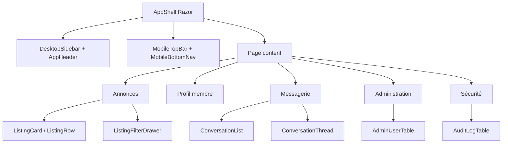

# Décisions UI pour PrivateListings

Date : 2026-07-07  
Base étudiée : Metronic v9.5.0 local, principalement HTML/Tailwind.

## Décision principale

Le layout retenu pour PrivateListings est une adaptation de Demo 3 Compact Sidebar, combinée avec des pages métier réécrites en Razor. Demo 3 apporte la meilleure base desktop : compacte, lisible, moins imposante que Demo 1 et moins orientée back-office que Demo 10.

Sur mobile, PrivateListings ne doit pas reprendre un tableau de bord réduit. La structure mobile doit être pensée comme une application d’annonces : topbar courte, recherche accessible, bouton de publication visible, navigation basse pour les parcours fréquents, et drawer seulement pour les actions secondaires.

## Choix par surface

| Surface | Choix retenu | Décision |
|---|---|---|
| Layout desktop | Demo 3 Compact Sidebar | Sidebar d’icônes compacte, topbar avec recherche, contenu large. |
| Layout mobile | Structure mobile propriétaire + drawer Demo 3 | Navigation basse : Accueil, Rechercher, Publier, Messages, Compte. |
| Liste annonces | Retail Store Search Grid/List + Real Estate Card | Grille desktop, liste mobile, filtres drawer, tri, favoris. |
| Détail annonce | Real Estate Card + Retail Product Details | Galerie, prix ou nature de l’offre, localisation, contact, signalement. |
| Profil membre | Public Profile Plain + User Profile | Profil sobre, badges de confiance, annonces du membre, bio. |
| Messagerie | React Concepts Mail | Réécriture Razor avec liste conversations et fil. |
| Admin utilisateurs | Team Members sans DataTables | Table Blazor native avec recherche, statut, rôles et actions. |
| Sécurité du compte | Security Overview + Account Settings | Synthèse sécurité, mot de passe, 2FA, sessions, appareils. |
| Logs/audit | Security Logs | Table d’audit Blazor : date, acteur, action, cible, IP, résultat. |

## Templates rejetés pour le MVP

- Demo 1 comme structure complète : trop dense et trop tableau de bord.
- Demo 10 comme structure principale : trop sombre, trop admin.
- Team Members DataTables : dépendance `jquery` et `datatables-net` inutile.
- Retail Store complet : panier, checkout, wishlist et commandes hors sujet.
- Store Inventory : trop logistique.
- Concepts `crm`, `ai`, `api`, `calendar`, `todo` : trop SaaS génériques pour le MVP.
- Next.js SaaS Landing : marketing, pas une expérience applicative.
- Bootstrap v8 : non nécessaire et incompatible avec une base Tailwind propre.

## Règles d’adaptation

- Ne jamais coller une page Metronic complète dans Razor.
- Extraire uniquement les motifs visuels : grille, carte, badge, toolbar, table, drawer, formulaire.
- Remplacer le vocabulaire SaaS par le vocabulaire PrivateListings : annonces, membres, quartiers, entraide, services, événements, messages, modération.
- Supprimer les métriques artificielles, graphiques et widgets qui ne soutiennent pas une décision utilisateur.
- Garder une densité visuelle raisonnable : cartes sobres, listes scannables, boutons d’action explicites.
- Sur mobile, privilégier la liste et le contact rapide plutôt que les panneaux multiples.

## Liste des composants Razor à créer

### Layout

- `AppShell.razor`
- `AppHeader.razor`
- `DesktopSidebar.razor`
- `MobileTopBar.razor`
- `MobileBottomNav.razor`
- `SecondaryDrawer.razor`
- `UserMenu.razor`
- `NotificationMenu.razor`

### Composants partagés

- `PageToolbar.razor`
- `SearchBox.razor`
- `FilterChip.razor`
- `StatusBadge.razor`
- `TrustBadge.razor`
- `EmptyState.razor`
- `ConfirmDialog.razor`
- `PaginationBar.razor`
- `ResponsiveTabs.razor`

### Annonces

- `ListingCard.razor`
- `ListingRow.razor`
- `ListingGrid.razor`
- `ListingList.razor`
- `ListingFilters.razor`
- `ListingFilterDrawer.razor`
- `ListingSortSelector.razor`
- `ListingGallery.razor`
- `ListingDetailHeader.razor`
- `ListingContactPanel.razor`
- `ListingSafetyPanel.razor`
- `ListingReportDialog.razor`

### Profil membre

- `MemberProfileHeader.razor`
- `MemberTrustSummary.razor`
- `MemberAboutCard.razor`
- `MemberListings.razor`
- `MemberContactActions.razor`

### Messagerie

- `ConversationLayout.razor`
- `ConversationList.razor`
- `ConversationListItem.razor`
- `ConversationThread.razor`
- `MessageBubble.razor`
- `MessageComposer.razor`
- `ConversationEmptyState.razor`

### Administration

- `AdminUserTable.razor`
- `AdminUserFilters.razor`
- `AdminUserActionsMenu.razor`
- `UserRoleBadge.razor`
- `ModerationStatusBadge.razor`

### Sécurité et audit

- `AccountSecurityOverview.razor`
- `TwoFactorPanel.razor`
- `PasswordStatusCard.razor`
- `CurrentSessionsTable.razor`
- `TrustedDevicesTable.razor`
- `AuditLogTable.razor`
- `AuditSeverityBadge.razor`

## Architecture UI recommandée



## Placement conseillé des fichiers

Quand l’application Blazor sera créée, viser une organisation de ce type :

```text
src/
  PrivateListings.Web/
    Components/
      Layout/
      Shared/
      Listings/
      Profile/
      Messaging/
      Admin/
      Security/
    Styles/
      app.css
    wwwroot/
      assets/
        css/
        js/
        media/
        vendors/
    ClientAssets/
      metronic/
```

Si le dépôt est public, `ClientAssets/metronic/` doit rester hors versionnement. Les assets Metronic complets ne doivent pas être commis par facilité.

## Tailwind et JavaScript

Décision : Tailwind 4 doit être piloté par le projet Blazor, pas par une application React ou Next.js importée.

À faire :

- générer `wwwroot/assets/css/app.css` depuis `Styles/app.css` ;
- scanner les composants Razor avec `@source`;
- importer seulement les styles KTUI nécessaires ;
- utiliser Keenicons ou remplacer par une bibliothèque d’icônes cohérente, mais ne pas mélanger plusieurs systèmes sans raison ;
- garder l’état interactif en Blazor pour menus, filtres, tabs, modales et tables ;
- conserver KTUI temporairement seulement pour les comportements très simples.

À éviter :

- `jquery`;
- `datatables-net`;
- `react`, `next`, `radix-ui`, `sonner`, `motion`;
- `apexcharts`, `fullcalendar`, `tinymce`, `dropzone`, `leaflet` dans le MVP ;
- les scripts globaux Metronic si un composant Razor peut porter l’état proprement.

## Design mobile

Le mobile doit privilégier :

- une recherche toujours atteignable ;
- des filtres en drawer plein écran ou quasi plein écran ;
- des cartes annonces verticales avec image stable, prix ou type d’offre, localisation, badges et action contact ;
- une page détail avec CTA collant en bas : contacter, envoyer un message, signaler ;
- une messagerie avec bascule liste/conversation, pas deux colonnes tassées ;
- des tables admin transformées en cartes ou lignes scrollables selon le contexte.

## Accessibilité minimale

- Les boutons icônes doivent avoir `aria-label`.
- Les champs de recherche et filtres doivent être associés à des labels.
- Les badges de statut ne doivent pas reposer uniquement sur la couleur.
- Les drawers et modales doivent gérer focus, fermeture clavier et retour focus.
- Les tables admin doivent garder des en-têtes explicites et une alternative mobile lisible.
- Les inputs 2FA doivent conserver `autocomplete="one-time-code"` et des labels par chiffre ou une alternative équivalente.

## Décision licence

Ne pas copier l’intégralité de Metronic dans le dépôt. Les fichiers locaux `LICENSE-REMINDER.txt` et `LICENSE-NOTICE.txt`, ainsi que la documentation officielle Metronic, rappellent qu’une licence couvre un seul déploiement de production, qu’une licence Extended est requise pour un SaaS payant, et que le code source Metronic ne doit pas être redistribué publiquement dans un projet open source.

Décision opérationnelle :

- dépôt privé : copier uniquement les sources et assets nécessaires ;
- dépôt public : garder Metronic hors dépôt et utiliser un mécanisme privé de restauration/build ;
- production : vérifier le type de licence avant publication, surtout si PrivateListings devient payant.

## Prochaine étape recommandée

Créer un prototype Blazor minimal sans données réelles :

1. Shell Demo 3 simplifié.
2. Page liste annonces en grille et liste.
3. Page détail annonce.
4. Profil membre.
5. Messagerie liste/détail.
6. Admin utilisateurs avec table Blazor native.
7. Sécurité et audit.

Ce prototype doit mesurer le poids CSS/JS réel avant toute copie supplémentaire d’assets Metronic.
